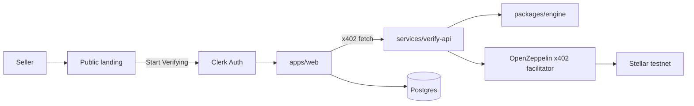

<div align="center">

# 🛡️ OrderVerify

**Verify M-Pesa payments before you dispatch. Stop fake payment SMS fraud.**

[](https://ov-ke-web.fly.dev/)
[](https://ov-ke-api.fly.dev/health)
[](https://t.me/ORDERVERIFY_BOT)

</div>

---

## 🔗 Live Links

| What | Link |
| --- | --- |
| 🌐 Web app | https://ov-ke-web.fly.dev/ |
| ⚙️ API health | https://ov-ke-api.fly.dev/health |
| 🤖 Telegram bot | [@ORDERVERIFY_BOT](https://t.me/ORDERVERIFY_BOT) |

### 📱 Scan to open the Telegram bot

<div align="center">
  
</div>

---

## 😩 The Problem

Online sellers in Kenya take orders over WhatsApp, Instagram and Telegram, and customers "pay" by sending an M-Pesa confirmation message. Sellers dispatch goods based on that message.

The trouble is:

- **Fake M-Pesa SMS** are easy to forge and look real.
- **Reused transaction codes** get sent to several sellers.
- **Edited amounts** turn KES 500 into KES 5,000 in a screenshot.
- **Missing receipts** and "reversed" or "locked balance" excuses slow everything down.

Sellers can't check Safaricom records, so they either lose money or delay genuine customers.

## ✅ The Solution

OrderVerify checks every payment against the seller's order **before dispatch** and returns one clear verdict:

| Verdict | Meaning |
| --- | --- |
| 🟢 **RELEASE** | Safe to dispatch |
| 🟡 **REVIEW** | Something is off, check manually |
| 🔴 **HOLD** | Don't dispatch |

**Verdicts come from a deterministic TypeScript rules engine, not a language model.** There is no AI guessing about your money.

### Key principles

- **No false confidence.** A text-only match is never shown as "verified". Only a receipt found on an **uploaded M-Pesa statement** earns the solid green badge. Everything else shows an outline badge: *"Looks consistent (not checked against M-Pesa records)"*.
- **Cross-shop detection.** If the same code appears in another shop's statement, the verdict becomes HOLD. If it appears in another shop's claims, it becomes REVIEW. Verdicts are only ever raised, never lowered.
- **Pay per batch, not per month.** Each paid check settles **0.01 USDC** on Stellar testnet via x402.
- **AI is optional and boxed in.** If an API key is present, the model may extract orders from chat and draft a buyer reply. It can never change or choose a verdict.

## ⚙️ How It Works

1. **Paste** the customer chat, M-Pesa SMS, and optionally upload an M-Pesa statement.
2. **Extract** orders from the chat (LLM if configured, otherwise a regex extractor).
3. **Pay** 0.01 USDC through x402. The API replies `402`, the web server signs the payment, and the request is retried with proof of payment.
4. **Verify** with the rules engine: it matches codes, amounts, payer names and statement rows, then flags reused codes, amount edits, missing receipts and locked balances.
5. **Verdict** per order (RELEASE / REVIEW / HOLD) with the reasons.
6. **History** is stored encrypted per seller. Reports can be reopened, downloaded as PDF, or deleted.

## 🏗️ Architecture



| Piece | Role |
| --- | --- |
| `apps/web` | Next.js 15 app: landing, Clerk session, dashboard, check flow, history, wallet, settings. Signs the Stellar payment **server-side**; the browser never holds `AGENT_SECRET`. |
| `services/verify-api` | Paid verification API. No database, no model. Idempotency keys stop retries being charged twice. |
| `packages/engine` | Pure, deterministic rules. No network, no clock, no database. |
| `packages/fixtures` | Demo data and the 30-order eval set. |

## 🧰 Tech Stack

| Layer | Tech |
| --- | --- |
| Frontend | Next.js 15, React, TypeScript |
| Auth | Clerk |
| Backend | Node.js, TypeScript (verify-api) |
| Rules engine | Pure TypeScript |
| Database | Postgres (Neon / Supabase) |
| Payments | x402 (HTTP 402), USDC on Stellar testnet, OpenZeppelin facilitator |
| Optional AI | Anthropic API for order extraction only |
| Email (optional) | Resend |
| Validation | zod |
| Tooling | npm workspaces, Vitest, ESLint, Prettier, Docker |
| Hosting | Fly.io (web + API) |
| Interfaces | Web app + Telegram bot |

## 🔒 Security & Privacy

- Names, phones and transaction codes are encrypted with **AES-256-GCM** and looked up with **HMAC-SHA256**.
- History is scoped per seller. Deleting reports cascades to orders, reports and M-Pesa rows.
- Chat and SMS text are treated as **untrusted input**. Prompts wrap them in delimited data blocks, and LLM output is validated with zod.
- A weekly KES spending cap is enforced **server-side before** any payment is signed.
- `X402_MODE=bypass` is for local UI work only. It shows a red banner and is ignored in production.

## 🚀 Run Locally

Requires Node 20+ and Docker (Postgres on port **5433**).

```bash
npm install
docker compose up -d
cp .env.example .env
```

Generate two different secrets and set `DATA_ENCRYPTION_KEY` and `HASH_PEPPER`:

```bash
openssl rand -hex 32
```

```bash
npm run db:migrate
npm run dev
```

Web runs on `:3000`, verify-api on `:4021`.

### Live x402 payments

```bash
node scripts/setup-wallets.mjs
```

1. Fund the agent address with testnet USDC: https://faucet.circle.com/
2. Create an `OZ_API_KEY`: https://channels.openzeppelin.com/testnet/gen
3. Set `X402_MODE=live`, `AGENT_SECRET`, `SERVICE_RECIPIENT`, `OZ_API_KEY`, then restart.

### Environment variables

| Name | Role |
| --- | --- |
| `DATABASE_URL` | Postgres connection |
| `VERIFY_API_URL` | Web → verify-api (default `http://localhost:4021`) |
| `X402_MODE` | `live` or `bypass` |
| `PRICE_USD` | Price per batch (default `0.01`) |
| `MAX_ORDERS_PER_BATCH` | Default 50 |
| `AGENT_SECRET` | Stellar payer secret (server only) |
| `OZ_API_KEY` / `FACILITATOR_URL` / `SERVICE_RECIPIENT` | x402 settlement |
| `NEXT_PUBLIC_CLERK_PUBLISHABLE_KEY` / `CLERK_SECRET_KEY` | Clerk |
| `DATA_ENCRYPTION_KEY` / `HASH_PEPPER` | 32-byte hex secrets |
| `ANTHROPIC_API_KEY` | Optional, for extraction |
| `RESEND_API_KEY` / `EMAIL_FROM` | Optional, report email |
| `DEFAULT_WEEKLY_CAP_KES` | Default 50 |
| `KEEP_RECORDS_DAYS` | Default 365 |

## 🧪 Tests & Evals

```bash
npm test
npm run eval
npm run typecheck
npm run system-check
```

## 🎬 Demo
##For telegram, scan here 

1. Sign in and open **Check**.
2. Click **Try with sample orders**.
3. Run once **without** a statement: you get outline badges, and obvious forgeries are held.
4. Run again **with** the statement: the fabricated receipt is held because it isn't on the statement.

Full script: `docs/DEMO_SCRIPT.md`

## ☁️ Deployment

- **Web:** Fly.io, [`fly.web.toml`](fly.web.toml) and `Dockerfile.web`
- **API:** Fly.io, [`fly.api.toml`](fly.api.toml) and `Dockerfile.api`
- **Database:** Postgres (Neon / Supabase)
- **Health checks:** `GET /api/health` (web) · `GET /health` (API)

## ⚠️ Limits

- A well-made fake SMS with a realistic code can't be caught from text alone. Upload a statement for real verification.
- OrderVerify does **not** call Safaricom and can't see live balances.
- A different payer name is REVIEW, not HOLD on its own.

See `docs/LIMITS.md`.

## 📄 Docs

`docs/` has architecture notes, limits, the demo script and privacy details.

---

<div align="center">
Built for Kenyan sellers 🇰🇪
</div>
