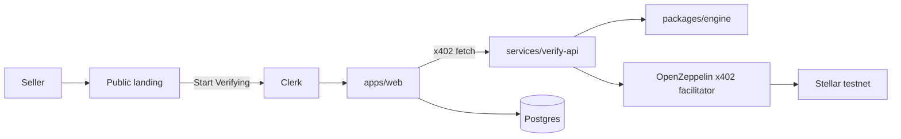

# OrderVerify

OrderVerify checks M-Pesa payments against a seller’s orders before dispatch. Verdicts are **RELEASE**, **REVIEW**, or **HOLD**. They come from a deterministic TypeScript rules engine, not from a language model.

A text-only match is never shown as verified. Only a receipt found on an uploaded M-Pesa statement earns the solid green badge. Everything else that looks consistent uses an outline badge: *Looks consistent (not checked against M-Pesa records)*.

Each paid check settles **0.01 USDC** on Stellar testnet through x402 (HTTP 402, then a signed payment). `X402_MODE=bypass` exists for local UI work only. It paints a red **BYPASS: not a real payment** banner and is ignored when `NODE_ENV=production`.

## What it does

- Matches pasted chat, M-Pesa SMS, and optional statement rows against each order.
- Flags reused codes, amount edits, missing receipts, locked balances, and other text-level inconsistencies.
- Raises a verdict when the same code appears in another shop’s statement (HOLD) or claims (REVIEW). Verdicts are never lowered.
- Stores encrypted history per signed-in seller. Reports can be opened, downloaded as PDF, deleted one-by-one, or wiped for that shop.
- Charges per batch, not per month. A weekly KES cap is enforced on the server before the payment is signed.

The model, when an API key is present, may extract orders from chat and draft a buyer reply. It never sees payment verdicts as something it can change, and it never chooses RELEASE / REVIEW / HOLD.

## Architecture



| Piece | Role |
| --- | --- |
| `apps/web` | Next.js 15 app: public landing, Clerk session, dashboard, check flow, history, wallet, settings. Signs the Stellar payment on the server. The browser never holds `AGENT_SECRET`. |
| `services/verify-api` | Paid verification API. No database, no model. Idempotency keys are cached in memory so a retry is not charged twice. |
| `packages/engine` | Pure rules. `now` is injected. No network, no clock, no Postgres. |
| `packages/fixtures` | Demo day and the 30-order eval set. |

Chat text and M-Pesa text are untrusted input. Prompts wrap them in delimited data blocks. Extracted LLM output is validated with zod and falls back to the regex extractor.

## Auth and data

Sellers sign in with Clerk (`your-clerk-key`). `sellers.id` is the Clerk user id. The public routes are `/`, `/sign-in`, `/sign-up`, and `GET /api/health`. Everything else requires a session. After sign-in or sign-up the app lands on `/dashboard`.

Names, phones, and transaction codes are stored with AES-256-GCM (`DATA_ENCRYPTION_KEY`) and looked up with HMAC-SHA256 (`HASH_PEPPER`). Plaintext name and code columns stay empty on insert. History is scoped to `batches.sellerId`. Deleting selected reports or all history cascades to orders, reports, and M-Pesa rows for that seller; the Clerk account remains.

Schema lives in `apps/web/src/server/db/schema.ts`. Apply `0001_init.sql`, `0002_clerk_sellers.sql`, and `0003_encrypted_history.sql`.

## Repository

```
apps/web                 Next.js product and Postgres access
services/verify-api      x402-gated verification HTTP API
packages/engine          Deterministic checks and parsers
packages/fixtures        Sample chats, SMS, statements, eval set
scripts/                 Eval, wallets, x402 smoke, system-check
docs/                    Architecture, limits, demo script, privacy
```

## Local setup

Node 20+ and Docker (Postgres on host port **5433**).

```bash
npm install
docker compose up -d
cp .env.example .env
```

Generate two different 32-byte hex secrets and set `DATA_ENCRYPTION_KEY` and `HASH_PEPPER`:

```bash
openssl rand -hex 32
```

Link Clerk and pull keys (from the repo root, in your own terminal):

```bash
npx -y clerk@latest auth login
npx -y clerk@latest link --app your-clerk-key
npx -y clerk@latest env pull
```

```bash
npm run db:migrate
npm run dev
```

That starts the web app on `:3000` and verify-api on `:4021`.

For UI work without testnet USDC, set `X402_MODE=bypass`. Do not enable that in a production build.

### Live x402

```bash
node scripts/setup-wallets.mjs
```

1. Fund the agent address with testnet USDC: https://faucet.circle.com/
2. Create `OZ_API_KEY`: https://channels.openzeppelin.com/testnet/gen
3. Set `X402_MODE=live`, `AGENT_SECRET`, `SERVICE_RECIPIENT`, and `OZ_API_KEY`, then restart.

```bash
# verify-api must already be running in live mode
X402_SMOKE=1 node scripts/x402-smoke.mjs
```

An unpaid call returns 402. A paid call returns 200, the settlement, and a Stellar Expert testnet link.

## Environment

Copy `.env.example`. The important groups:

| Name | Role |
| --- | --- |
| `DATABASE_URL` | Postgres. Local default uses port 5433. |
| `VERIFY_API_URL` | Web → verification service. Default `http://localhost:4021`. |
| `X402_MODE` | `live` or `bypass`. Bypass is a no-op in production. |
| `PRICE_USD` | Price of one batch. Default `0.01`. |
| `MAX_ORDERS_PER_BATCH` | Larger bodies are 413. Default 50. |
| `AGENT_SECRET` | Stellar payer secret. Server only. |
| `OZ_API_KEY` / `FACILITATOR_URL` / `SERVICE_RECIPIENT` | OpenZeppelin testnet settlement. |
| `NEXT_PUBLIC_CLERK_PUBLISHABLE_KEY` / `CLERK_SECRET_KEY` | Clerk. Secret stays off the client. |
| `DATA_ENCRYPTION_KEY` / `HASH_PEPPER` | 32-byte hex. Required before history writes. |
| `ANTHROPIC_API_KEY` | Optional extraction. Empty → regex extractor. |
| `RESEND_API_KEY` / `EMAIL_FROM` | Optional report email. |
| `DEFAULT_WEEKLY_CAP_KES` | Cap for a new seller. Default 50. |
| `KEEP_RECORDS_DAYS` | Encrypted history retention. Default 365. |

## Checks

```bash
npm test
npm run eval
npm run typecheck
npm run system-check
node scripts/check-client-secrets.mjs
```

`npm run eval` writes `eval-results.json`. Text-only misses the two fabricated codes; a statement that does not contain them holds those orders. That miss is intentional.

`npm run system-check` seeds two mock shops, walks engine + history + delete + cross-shop, and hits verify-api with payment off. It does not charge x402. Pass `--clean` to drop the mock sellers.

## Demo

Sign in, open **Check**, use **Try with sample orders**. Run once without a statement, then again with it. The first run shows outline badges and holds the obvious forgeries. The second run holds the fabricated receipt because it is not on the statement. Script: `docs/DEMO_SCRIPT.md`.

History must open the stored report (`/batches/[id]`). It does not start another paid check.

## Deploy

- `apps/web` on Vercel. Set the env vars. Do not set `X402_MODE=bypass`.
- `services/verify-api` on a public HTTPS host (Railway, Render), always on.
- Postgres on Neon or Supabase. Run `npm run db:migrate`.
- Health: `GET /api/health` on web, `GET /health` on verify-api.

## Limits

A well-made fake SMS whose code looks real cannot be caught from the text alone. OrderVerify does not call Safaricom and cannot see a live balance. A different payer name is REVIEW, not HOLD by itself. See `docs/LIMITS.md`.
