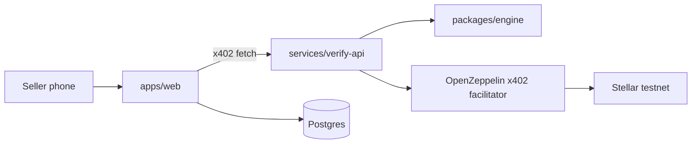

# OrderVerify

OrderVerify holds a risky M-Pesa order before a small seller dispatches it. She pastes the chat and the payment messages. The app buys a verification check for about **0.01 USDC** on Stellar testnet, using the x402 protocol (HTTP 402, then a signed payment). A rules engine, not a language model, decides hold, check first, or release.

A text-only release is never shown as "Verified". Only a check against her uploaded M-Pesa statement earns the solid green badge.

## Architecture



The verification service has no database and no model. Any agent can pay it. This web app is the first client. The signing key stays on the server.

## Setup

Requirements: Node 20+, Docker (for local Postgres).

```bash
npm install
docker compose up -d
copy .env.example .env
```

On macOS or Linux, use `cp` instead of `copy`.

Generate the two history secrets (32-byte hex) and put them in `.env`:

```bash
openssl rand -hex 32
```

Use one value for `DATA_ENCRYPTION_KEY` and a different value for `HASH_PEPPER`.

Clerk: this repo is wired to the Dashboard-selected application. In your own terminal, from the repo root:

```bash
npx -y clerk@latest auth login
npx -y clerk@latest link --app app_3MWdgauxcDoxwOblGVrxwLg5vMz
npx -y clerk@latest env pull
```

Then:

```bash
npm run db:migrate
```

For local UI work without testnet USDC, set `X402_MODE=bypass` in `.env`. The app shows a red banner: **BYPASS: not a real payment**. That flag is ignored when `NODE_ENV=production`.

```bash
npm run dev
```


### A real payment

```bash
node scripts/setup-wallets.mjs
```

Then, by hand:

1. Get testnet USDC for the agent address at https://faucet.circle.com/
2. Create `OZ_API_KEY` at https://channels.openzeppelin.com/testnet/gen

Put both in `.env`, set `X402_MODE=live`, and restart. Refill the agent from the Circle faucet when the testnet balance runs low. A few dollars of testnet USDC covers well over 200 checks at 0.01 each.

```bash
# Terminal A: the API must be running in live mode
# Terminal B:
set X402_SMOKE=1
node scripts/x402-smoke.mjs
```

An unpaid call prints 402. The paid call prints 200, the settlement, and a Stellar Expert testnet link.

## Environment

| Name | Role |
| --- | --- |
| `STELLAR_NETWORK` | `stellar:testnet` |
| `PRICE_USD` | Price of one batch. Default `0.01` |
| `MAX_ORDERS_PER_BATCH` | Larger batches are rejected with 413 |
| `KES_PER_USD` | Display rate only |
| `PORT` | Verification service port, default 4021 |
| `FACILITATOR_URL` | OpenZeppelin testnet facilitator |
| `OZ_API_KEY` | Bearer token for the facilitator |
| `SERVICE_RECIPIENT` | Classic `G...` account that receives USDC |
| `DATABASE_URL` | Postgres |
| `VERIFY_API_URL` | Where the web app sends batches |
| `AGENT_SECRET` | Payer secret. Server only |
| `ANTHROPIC_API_KEY` | Optional. Without it, extraction is deterministic |
| `ANTHROPIC_MODEL` | Default `claude-sonnet-5-5` |
| `X402_MODE` | `live` or `bypass` (bypass cannot run in production) |
| `DEFAULT_WEEKLY_CAP_KES` | Cap for a new seller. Default 50 |
| `NEXT_PUBLIC_CLERK_PUBLISHABLE_KEY` | Clerk publishable key |
| `CLERK_SECRET_KEY` | Clerk secret. Server only |
| `NEXT_PUBLIC_CLERK_SIGN_IN_URL` | `/sign-in` |
| `NEXT_PUBLIC_CLERK_SIGN_UP_URL` | `/sign-up` |
| `NEXT_PUBLIC_CLERK_SIGN_IN_FALLBACK_REDIRECT_URL` | `/dashboard` after sign-in |
| `NEXT_PUBLIC_CLERK_SIGN_UP_FALLBACK_REDIRECT_URL` | `/dashboard` after sign-up |
| `DATA_ENCRYPTION_KEY` | 32-byte hex AES-256-GCM key for names, phones, and codes |
| `HASH_PEPPER` | 32-byte hex HMAC pepper for searchable hashes |
| `KEEP_RECORDS_DAYS` | Encrypted history retention. Default 365 |
| `RESEND_API_KEY` | Email provider used to send verification reports to users |
| `EMAIL_FROM` | OrderVerify from-address |

## Checks

```bash
npm test
npm run eval
node scripts/check-client-secrets.mjs
```

`npm run eval` writes `eval-results.json` and refreshes the numbers on `/evals`. The made-up codes are missed from text alone and caught when the statement does not contain them. That miss is the point.

## Demo

Open the app, tap **Try with sample orders**, run once without the statement, then run again with it. The script is in `docs/DEMO_SCRIPT.md`.

## Deploy

- `apps/web` on Vercel. Set the env vars. Do not set `X402_MODE=bypass`.
- `services/verify-api` on Railway or Render, always on, public HTTPS.
- Postgres on Neon or Supabase. Run `npm run db:migrate` so `0001_init.sql`, `0002_clerk_sellers.sql`, and `0003_encrypted_history.sql` all apply.
- Health: `GET /api/health` on the web app, `GET /health` on the verification service.

## Limits

See `docs/LIMITS.md`. A believable fake message cannot be caught from text alone.
