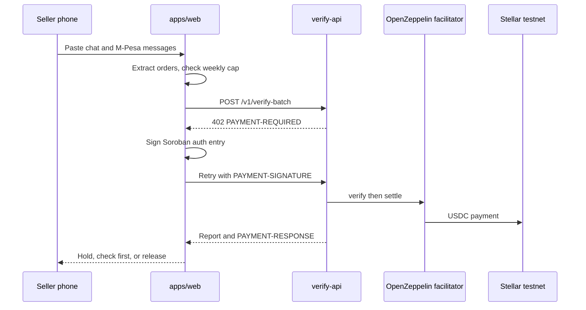

# Architecture

OrderVerify is two programs and one pure library.

`packages/engine` is pure TypeScript. It parses messages, runs the checks, and chooses RELEASE, REVIEW, or HOLD. It has no clock of its own (`now` is passed in), no database, and no model.

`services/verify-api` is the thing being sold. Any agent can pay it. It has no database and no model. An idempotency key is cached in memory before the payment middleware, so a retry is not charged again.

`apps/web` is the first client. The browser never holds the agent secret. The Next.js server signs the Stellar payment, stores the report, and enforces the weekly cap inside a database transaction before it pays.

## Trust

| What you uploaded | What a release means |
| --- | --- |
| Message text only | Looks consistent. Not checked against M-Pesa records. Outline badge. |
| Statement covering the payment date | Verified against your statement. Solid badge. |

A fail is always HOLD. A warning is REVIEW. The model may extract orders and draft a reply. It never chooses the verdict.

## Data

Postgres holds the seller, batches, orders (no full phone numbers), payment text, statement rows, accepted codes, reports, x402 payment attempts, and the activity timeline. See `apps/web/drizzle/0001_init.sql`.
